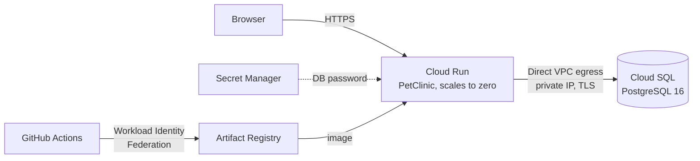

# Spring PetClinic on Google Cloud

[](https://github.com/coldworld22/spring-petclinic/actions/workflows/terraform-gcp.yml)


This fork takes the official Spring PetClinic and makes it production-ready on Google Cloud **without changing a line of application code**. Everything is in [`infra/gcp`](infra/gcp) and two GitHub Actions workflows.

## What this fork adds



- **Cloud Run** runs the app and scales to zero when nobody is using it, so an idle demo costs almost nothing.
- **Cloud SQL for PostgreSQL 16** has **no public IP**. Cloud Run reaches it over the VPC with Direct VPC egress, so no Serverless VPC connector is needed, and connections must use TLS. Daily backups and point-in-time recovery are on.
- **Secret Manager** holds the database password. Terraform generates it and Cloud Run injects it at start-up; it never appears in the repository or in a workflow.
- **Artifact Registry** stores images built with Cloud Native Buildpacks (`spring-boot:build-image`), so there's no Dockerfile to maintain. It keeps the 10 most recent images.
- **Workload Identity Federation:** GitHub Actions gets short-lived credentials. Only the `main` branch of this repository may deploy, and no service account key exists anywhere.
- **Least-privilege service accounts:** the app can read only its own secret. The deployer can only push images and roll out new revisions.
- **Hardening:** upstream exposes every actuator endpoint, which is fine on a laptop. In the cloud, only `health` and `info` are exposed. Startup and liveness probes use `/actuator/health`.
- **Default region `me-central2` (Dammam, Saudi Arabia)**, to keep data in the Kingdom.

## Running on Google Cloud

You need a Google Cloud project with billing, the `gcloud` CLI and Terraform.

```bash
gcloud auth application-default login
cd infra/gcp
cp terraform.tfvars.example terraform.tfvars   # set project_id
terraform init
terraform apply
```

The first apply runs a placeholder image. To deploy PetClinic itself, add these **repository variables** in GitHub (Settings → Secrets and variables → Actions → Variables), using the Terraform outputs:

| Variable | Value |
|---|---|
| `GCP_PROJECT_ID` | your project ID |
| `GCP_WORKLOAD_IDENTITY_PROVIDER` | output `workload_identity_provider` |
| `GCP_DEPLOY_SERVICE_ACCOUNT` | output `deployer_service_account` |

Then run **Deploy to Google Cloud Run** from the Actions tab. It builds the image, pushes it, deploys a new revision and prints the URL.

**Cost:** Cloud Run is within the free tier for a demo. The `db-f1-micro` database is the main cost, at roughly 10–15 USD a month. Run `terraform destroy` to remove everything.

## Design decisions

- **Why no code changes?** PetClinic already reads its database settings from environment variables. Keeping the fork's diff to infrastructure makes it easy to pull in upstream updates, and shows that the platform work is separate from the app.
- **Why private IP instead of the Cloud SQL Auth Proxy?** The database simply has no public address, so there's nothing to attack from the internet. Direct VPC egress gives Cloud Run a route to it without paying for a VPC connector.
- **Why does Terraform ignore the container image?** Terraform owns the infrastructure, and the pipeline owns releases. Without `ignore_changes`, every `terraform apply` would roll the service back to whatever image was in the code.
- **Why Workload Identity Federation?** A leaked service account key is valid until someone notices. A federated token lasts minutes and only works for this repository's `main` branch.

---

*The original PetClinic README follows.*

# Spring PetClinic Sample Application [](https://github.com/spring-projects/spring-petclinic/actions/workflows/maven-build.yml)[](https://github.com/spring-projects/spring-petclinic/actions/workflows/gradle-build.yml)

[](https://gitpod.io/#https://github.com/spring-projects/spring-petclinic) [](https://github.com/codespaces/new?hide_repo_select=true&ref=main&repo=7517918)

## Understanding the Spring Petclinic application with a few diagrams

See the presentation here:  
[Spring Petclinic Sample Application (legacy slides)](https://speakerdeck.com/michaelisvy/spring-petclinic-sample-application?slide=20)

> **Note:** These slides refer to a legacy, pre–Spring Boot version of Petclinic and may not reflect the current Spring Boot–based implementation.  
> For up-to-date information, please refer to this repository and its documentation.


## Run Petclinic locally

Spring Petclinic is a [Spring Boot](https://spring.io/guides/gs/spring-boot) application built using [Maven](https://spring.io/guides/gs/maven/) or [Gradle](https://spring.io/guides/gs/gradle/).
Java 17 or later is required for the build, and the application can run with Java 17 or newer.

You first need to clone the project locally:

```bash
git clone https://github.com/spring-projects/spring-petclinic.git
cd spring-petclinic
```
If you are using Maven, you can start the application on the command-line as follows:

```bash
./mvnw spring-boot:run
```
With Gradle, the command is as follows:

```bash
./gradlew bootRun
```

You can then access the Petclinic at <http://localhost:8080/>.


You can, of course, run Petclinic in your favorite IDE.
See below for more details.

## Building a Container

There is no `Dockerfile` in this project. You can build a container image (if you have a docker daemon) using the Spring Boot build plugin:

```bash
./mvnw spring-boot:build-image
```

## In case you find a bug/suggested improvement for Spring Petclinic

Our issue tracker is available [here](https://github.com/spring-projects/spring-petclinic/issues).

## Database configuration

In its default configuration, Petclinic uses an in-memory database (H2) which
gets populated at startup with data. The h2 console is exposed at `http://localhost:8080/h2-console`,
and it is possible to inspect the content of the database using the `jdbc:h2:mem:<uuid>` URL. The UUID is printed at startup to the console.

A similar setup is provided for MySQL and PostgreSQL if a persistent database configuration is needed. Note that whenever the database type changes, the app needs to run with a different profile: `spring.profiles.active=mysql` for MySQL or `spring.profiles.active=postgres` for PostgreSQL. See the [Spring Boot documentation](https://docs.spring.io/spring-boot/how-to/properties-and-configuration.html#howto.properties-and-configuration.set-active-spring-profiles) for more detail on how to set the active profile.

You can start MySQL or PostgreSQL locally with whatever installer works for your OS or use docker:

```bash
docker run -e MYSQL_USER=petclinic -e MYSQL_PASSWORD=petclinic -e MYSQL_ROOT_PASSWORD=root -e MYSQL_DATABASE=petclinic -p 3306:3306 mysql:9.6
```

or

```bash
docker run -e POSTGRES_USER=petclinic -e POSTGRES_PASSWORD=petclinic -e POSTGRES_DB=petclinic -p 5432:5432 postgres:18.3
```

Further documentation is provided for [MySQL](https://github.com/spring-projects/spring-petclinic/blob/main/src/main/resources/db/mysql/petclinic_db_setup_mysql.txt)
and [PostgreSQL](https://github.com/spring-projects/spring-petclinic/blob/main/src/main/resources/db/postgres/petclinic_db_setup_postgres.txt).

Instead of vanilla `docker` you can also use the provided `docker-compose.yml` file to start the database containers. Each one has a service named after the Spring profile:

```bash
docker compose up mysql
```

or

```bash
docker compose up postgres
```

## Test Applications

At development time we recommend you use the test applications set up as `main()` methods in `PetClinicIntegrationTests` (using the default H2 database and also adding Spring Boot Devtools), `MySqlTestApplication` and `PostgresIntegrationTests`. These are set up so that you can run the apps in your IDE to get fast feedback and also run the same classes as integration tests against the respective database. The MySql integration tests use Testcontainers to start the database in a Docker container, and the Postgres tests use Docker Compose to do the same thing.

## Compiling the CSS

There is a `petclinic.css` in `src/main/resources/static/resources/css`. It was generated from the `petclinic.scss` source, combined with the [Bootstrap](https://getbootstrap.com/) library. If you make changes to the `scss`, or upgrade Bootstrap, you will need to re-compile the CSS resources using the Maven profile "css", i.e. `./mvnw package -P css`. There is no build profile for Gradle to compile the CSS.

## Working with Petclinic in your IDE

### Prerequisites

The following items should be installed in your system:

- Java 17 or newer (full JDK, not a JRE)
- [Git command line tool](https://help.github.com/articles/set-up-git)
- Your preferred IDE
  - Eclipse with the m2e plugin. Note: when m2e is available, there is a m2 icon in `Help -> About` dialog. If m2e is
  not there, follow the installation process [here](https://www.eclipse.org/m2e/)
  - [Spring Tools Suite](https://spring.io/tools) (STS)
  - [IntelliJ IDEA](https://www.jetbrains.com/idea/)
  - [VS Code](https://code.visualstudio.com)

### Steps

1. On the command line run:

    ```bash
    git clone https://github.com/spring-projects/spring-petclinic.git
    ```

1. Inside Eclipse or STS:

    Open the project via `File -> Import -> Maven -> Existing Maven project`, then select the root directory of the cloned repo.

    Then either build on the command line `./mvnw generate-resources` or use the Eclipse launcher (right-click on project and `Run As -> Maven install`) to generate the CSS. Run the application's main method by right-clicking on it and choosing `Run As -> Java Application`.

1. Inside IntelliJ IDEA:

    In the main menu, choose `File -> Open` and select the Petclinic [pom.xml](pom.xml). Click on the `Open` button.

    - CSS files are generated from the Maven build. You can build them on the command line `./mvnw generate-resources` or right-click on the `spring-petclinic` project then `Maven -> Generates sources and Update Folders`.

    - A run configuration named `PetClinicApplication` should have been created for you if you're using a recent Ultimate version. Otherwise, run the application by right-clicking on the `PetClinicApplication` main class and choosing `Run 'PetClinicApplication'`.

1. Navigate to the Petclinic

    Visit [http://localhost:8080](http://localhost:8080) in your browser.

## Looking for something in particular?

|Spring Boot Configuration | Class or Java property files  |
|--------------------------|---|
|The Main Class | [PetClinicApplication](https://github.com/spring-projects/spring-petclinic/blob/main/src/main/java/org/springframework/samples/petclinic/PetClinicApplication.java) |
|Properties Files | [application.properties](https://github.com/spring-projects/spring-petclinic/blob/main/src/main/resources) |
|Caching | [CacheConfiguration](https://github.com/spring-projects/spring-petclinic/blob/main/src/main/java/org/springframework/samples/petclinic/system/CacheConfiguration.java) |

## Interesting Spring Petclinic branches and forks

The Spring Petclinic "main" branch in the [spring-projects](https://github.com/spring-projects/spring-petclinic)
GitHub org is the "canonical" implementation based on Spring Boot and Thymeleaf. There are
[quite a few forks](https://spring-petclinic.github.io/docs/forks.html) in the GitHub org
[spring-petclinic](https://github.com/spring-petclinic). If you are interested in using a different technology stack to implement the Pet Clinic, please join the community there.

## Interaction with other open-source projects

One of the best parts about working on the Spring Petclinic application is that we have the opportunity to work in direct contact with many Open Source projects. We found bugs/suggested improvements on various topics such as Spring, Spring Data, Bean Validation and even Eclipse! In many cases, they've been fixed/implemented in just a few days.
Here is a list of them:

| Name | Issue |
|------|-------|
| Spring JDBC: simplify usage of NamedParameterJdbcTemplate | [SPR-10256](https://github.com/spring-projects/spring-framework/issues/14889) and [SPR-10257](https://github.com/spring-projects/spring-framework/issues/14890) |
| Bean Validation / Hibernate Validator: simplify Maven dependencies and backward compatibility |[HV-790](https://hibernate.atlassian.net/browse/HV-790) and [HV-792](https://hibernate.atlassian.net/browse/HV-792) |
| Spring Data: provide more flexibility when working with JPQL queries | [DATAJPA-292](https://github.com/spring-projects/spring-data-jpa/issues/704) |

## Contributing

The [issue tracker](https://github.com/spring-projects/spring-petclinic/issues) is the preferred channel for bug reports, feature requests and submitting pull requests.

For pull requests, editor preferences are available in the [editor config](.editorconfig) for easy use in common text editors. Read more and download plugins at <https://editorconfig.org>. All commits must include a __Signed-off-by__ trailer at the end of each commit message to indicate that the contributor agrees to the Developer Certificate of Origin.
For additional details, please refer to the blog post [Hello DCO, Goodbye CLA: Simplifying Contributions to Spring](https://spring.io/blog/2025/01/06/hello-dco-goodbye-cla-simplifying-contributions-to-spring).

## License

The Spring PetClinic sample application is released under version 2.0 of the [Apache License](https://www.apache.org/licenses/LICENSE-2.0).
